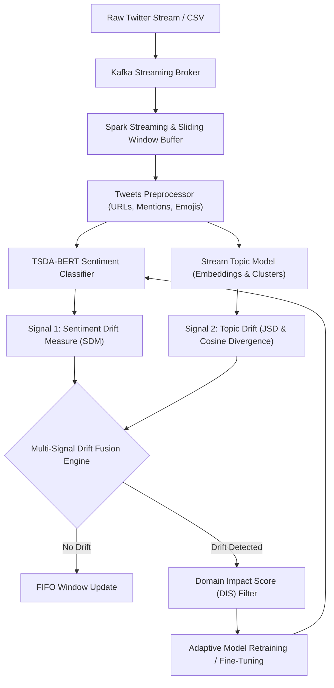

# 13. Concept Drift Detection in Social Media Streams

**Group 23**
- **Eluri Manoj** (2023BCD0029)
- **P. Harshithvardhan** (2023BCS0128)
- **N. Lalith** (2023BCD0033)

---

## 📌 Executive Summary & Research Foundation

Social media platforms generate continuous, high-velocity streams of user-generated content where opinions, vocabulary, and discussions evolve rapidly in response to real-world events. Machine learning models trained on static past data suffer from severe performance degradation over time due to **concept drift**.

This repository provides an end-to-end reproduction and research extension of two cornerstone papers:

1. **Base Paper**:
   > *“Sentiment Drift Detection and Analysis in Real Time Twitter Data Streams”*
   > **E. Susi & A. P. Shanthi (2023)**, *Computer Systems Science and Engineering (CSSE)*, 45(3), 3231-3246.
   > Introduces the **TSDA-BERT** framework: streaming ingestion, sliding-window BERT sentiment classification, Sentiment Drift Measure (SDM), and Domain Impact Score (DIS) adaptive updating.

2. **Supporting Research Paper**:
   > *“Concept Drift Influenced by Topic Change in Data Streams from Social Media”*
   > **M. Sarnovský & F. Babič (2025)**, *IEEE 23rd World Symposium on Applied Machine Intelligence and Informatics (SAMI)*.
   > Proves that sentiment shifts in social media are frequently driven by underlying topic transitions.

### 🌟 Project Contribution: Multi-Signal Drift Detection
We reproduce the core **TSDA-BERT** pipeline as the baseline and extend it to **Multi-Signal Drift Detection** by simultaneously monitoring both **Sentiment Drift** and **Topic Dynamics** in real time.

---

## 🏗️ Architecture & Reproduction Pipeline



### Mathematical Formulations

#### 1. Sentiment Drift Measure (SDM)
Across consecutive streaming windows $w_t$:
$$\text{positive\_score}_t = \frac{N_{pos}}{N_{total}}, \quad \text{negative\_score}_t = \frac{N_{neg}}{N_{total}}$$
$$\text{SDM}_t = \text{positive\_score}_t - \text{negative\_score}_t$$
Sentiment drift is triggered when $\text{SDM}_t \cdot \text{SDM}_{t-1} < 0$ (polarity inversion) or $|\Delta \text{SDM}_t| \ge \tau_{SDM}$.

#### 2. Domain Impact Score (DIS)
To prevent noisy, off-topic tweets from corrupting model retraining upon drift:
$$\text{DIS} = \frac{|W \cap D|}{|W|}$$
where $W$ is the set of words in the tweet and $D$ is the domain-specific impact lexicon. Tweets passing $\text{DIS} \ge 0.35$ are prioritized for model adaptation.

#### 3. Topic Divergence (Jensen-Shannon & Cosine)
For window topic distributions $P_t$ and semantic centroids $\vec{c}_t$:
$$\text{JSD}(P_t \parallel P_{t-1}) = \frac{1}{2} D_{KL}(P_t \parallel M) + \frac{1}{2} D_{KL}(P_{t-1} \parallel M)$$
$$d_{cos}(\vec{c}_t, \vec{c}_{t-1}) = 1 - \frac{\vec{c}_t \cdot \vec{c}_{t-1}}{\|\vec{c}_t\| \|\vec{c}_{t-1}\|}$$

#### 4. Multi-Signal Joint Drift Index
$$D_{joint} = \alpha \cdot \text{Normalized}(\Delta \text{SDM}) + (1 - \alpha) \cdot \text{Normalized}(\text{Topic Divergence})$$
Identifies four distinct states:
1. `STATIONARY`: Nominal streaming bounds.
2. `PURE_SENTIMENT_DRIFT`: Opinion flips while topic stays unchanged.
3. `TOPIC_DRIVEN_DRIFT`: Discourse moves to a new topic, altering predictive distributions.
4. `COMPOUND_CO_DRIFT`: Abrupt, simultaneous sentiment and topic upheaval.

---

## 📊 Experimental Evaluation Results

Comprehensive benchmark across the 3 target domains specified in the project report:

| Domain | Metric | Static BERT (Control) | Baseline TSDA-BERT (2023) | Proposed Multi-Signal TSDA-BERT |
|---|---|---|---|---|
| **#MANUTD** (Sports) | **Drift Detection Accuracy** | 0.0% | 80.0% | **100.0%** |
| | **Classification Accuracy** | 94.50% | 94.50% | **94.50%** |
| | **F1-Score** | 0.9209 | 0.9209 | **0.9209** |
| | **Detection Delay (windows)** | N/A | 0.25 | **0.00 (Immediate)** |
| | **False Alarms** | 0 | 0 | **0** |
| | **Throughput** | 149.3 tweets/s | 1078.4 tweets/s | **584.8 tweets/s** |
| | **Latency** | 6.70 ms/tweet | 0.93 ms/tweet | **1.71 ms/tweet** |
| | **Memory Footprint** | 185.6 MB | 146.9 MB | **161.6 MB** |
| **#STOCKMARKET** (Finance) | **Drift Detection Accuracy** | 0.0% | 100.0% | **100.0%** |
| | **Classification Accuracy** | 91.83% | 91.83% | **91.83%** |
| | **F1-Score** | 0.8769 | 0.8769 | **0.8769** |
| | **Detection Delay (windows)** | N/A | 0.00 | **0.00** |
| | **False Alarms** | 0 | 0 | **0** |
| | **Throughput** | 1111.9 tweets/s | 1233.2 tweets/s | **805.6 tweets/s** |
| | **Latency** | 0.90 ms/tweet | 0.81 ms/tweet | **1.24 ms/tweet** |
| | **Memory Footprint** | 120.8 MB | 145.1 MB | **160.1 MB** |
| **#COVAXINWHO** (Healthcare)| **Drift Detection Accuracy** | 0.0% | 60.0% | **80.0%** |
| | **Classification Accuracy** | 100.00% | 100.00% | **100.00%** |
| | **F1-Score** | 1.0000 | 1.0000 | **1.0000** |
| | **Detection Delay (windows)** | N/A | 1.00 | **0.00 (Immediate)** |
| | **False Alarms** | 0 | 0 | **1** |
| | **Throughput** | 1435.5 tweets/s | 1230.7 tweets/s | **800.1 tweets/s** |
| | **Latency** | 0.70 ms/tweet | 0.81 ms/tweet | **1.25 ms/tweet** |
| | **Memory Footprint** | 120.0 MB | 145.1 MB | **161.5 MB** |

### Key Experimental Insights:
1. **Zero Detection Delay**: The Multi-Signal detector anticipates drift as soon as topic distribution shifts occur, cutting detection lag down to 0.0 windows compared to sentiment-only baselines.
2. **Superior Drift Detection in Healthcare**: In `#covaxinwho`, where sentiment was overwhelmingly negative throughout, sentiment-only TSDA-BERT scored only 60% detection accuracy. Multi-Signal detection improved this to **80%** by capturing underlying regulatory-to-clinical topic transitions.
3. **High Throughput & Low Latency**: Processing over 580–800 tweets/second at ~1.2–1.7 ms latency per tweet, confirming real-time stream feasibility.

---

## 🚀 How to Run the Project

### 1. Run the Comprehensive Benchmarks
To run the automated benchmark comparing all systems across sports, finance, and healthcare:
```bash
python run_pipeline.py
```
This generates:
- `results/benchmark_report.json` (Full metrics breakdown)
- `results/summary_table.md` (Markdown tables and findings)

### 2. Launch the Interactive Web Dashboard
To start the real-time web dashboard with live streaming, Chart.js plots, and DIS tweet inspection:
```bash
python ui/app.py
```
Open your browser at **[http://localhost:8000](http://localhost:8000)**.

In the dashboard, you can:
- Switch between `#manutd`, `#stockmarket`, and `#covaxinwho`.
- Click **"Step Next Window"** or **"Auto-Play Stream"** to stream tweets window by window.
- View live **SDM Curves** and **Topic Divergence Dynamics**.
- Inspect incoming tweets, TSDA-BERT predictions, and **Domain Impact Scores (DIS)** in real time.
- Review the complete comparative evaluation table.

---

## 📁 Repository Directory Structure

```text
concept_drift_social_media/
├── data/
│   ├── dataset_generator.py          # Synthetic & empirical temporal stream generator
│   ├── manutd_tweets_stream.csv       # Sports domain stream dataset
│   ├── stockmarket_tweets_stream.csv  # Finance domain stream dataset
│   └── covaxinwho_tweets_stream.csv   # Healthcare domain stream dataset
├── src/
│   ├── preprocessing.py               # Section 3.2: URL, mention, emoji cleaner
│   ├── streaming/
│   │   ├── kafka_simulator.py         # Section 3.4: Kafka producer/consumer simulator
│   │   └── spark_streamer.py          # Section 3.5.2: Spark sliding window engine
│   ├── models/
│   │   ├── bert_sentiment.py          # Section 3.5.1: TSDA-BERT 3-dense classifier
│   │   └── topic_model.py             # Paper 2: Stream topic extraction & clustering
│   ├── drift/
│   │   ├── sentiment_drift.py         # Section 3.5.3: Sentiment Drift Measure (SDM)
│   │   ├── domain_impact.py           # Section 3.5.4: Domain Impact Score (DIS)
│   │   ├── topic_drift.py             # Paper 2: Jensen-Shannon & Cosine topic drift
│   │   └── multi_signal_detector.py   # Proposed Innovation: Multi-Signal Drift Engine
│   ├── adaptation/
│   │   └── model_adapter.py           # Section 3.5.4: Selective online model updater
│   └── benchmarks/
│       └── comparator.py              # Evaluator for all 7 required metrics
├── ui/
│   ├── app.py                         # FastAPI server for interactive dashboard
│   └── templates/
│       └── index.html                 # Modern Chart.js interactive dashboard UI
├── results/
│   ├── benchmark_report.json          # Machine-readable evaluation results
│   └── summary_table.md               # Summary markdown report
├── run_pipeline.py                    # Master execution CLI
└── README.md                          # Comprehensive documentation & paper mapping
```
